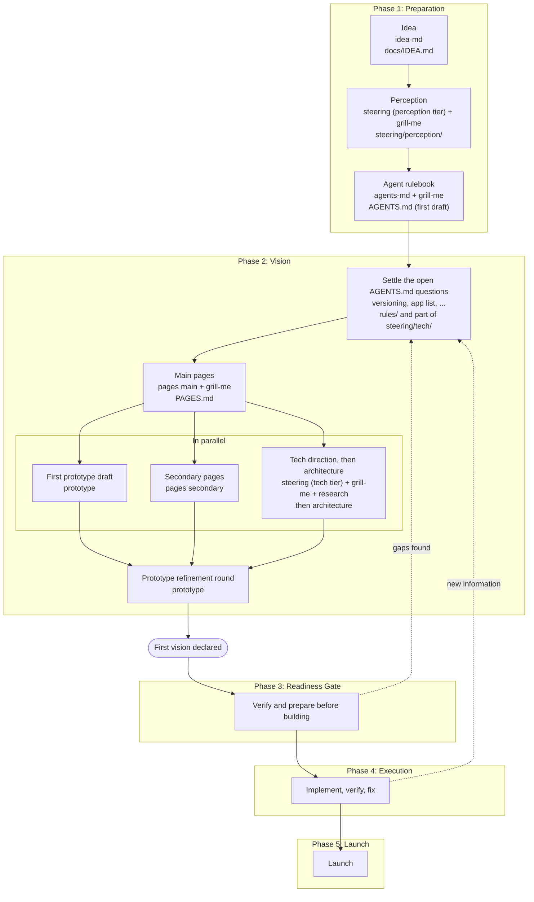

# Viber Lifecycle

> The path a project walks under Viber, from a raw idea to a launched product: which phase comes when, which Skill drives each step, what each step produces, and what may run in parallel. Skills that live in this group are linked; Skills that live elsewhere in the Viber catalog are named without links.

The lifecycle is a **default path, not a fixed script**. Routing selects Skills dynamically, questions are chosen from the answers already given, and any phase can send the project back to an earlier one when new information appears.

---

## 1. Overview



---

## 2. Phase Reference

| # | Phase | Step | Skill | Output |
|---|---|---|---|---|
| 1 | Preparation | Idea | [`idea-md`](idea-md/SKILL.md) | `docs/IDEA.md` |
| 1 | Preparation | Perception | [`steering`](steering/SKILL.md) (perception tier) + `grill-me` | `steering/perception/` |
| 1 | Preparation | Agent rulebook | [`agents-md`](agents-md/SKILL.md) + `grill-me` | `AGENTS.md`, a first draft that enables parallel work |
| 2 | Vision | Settle open rulebook questions | `grill-me` | answers go to `rules/`; some go to `steering/tech/` |
| 2 | Vision | Main pages | `pages main` + `grill-me` | `PAGES.md` |
| 2 | Vision | First prototype draft *(parallel)* | `prototype` | incomplete draft, which is expected |
| 2 | Vision | Secondary pages *(parallel)* | `pages secondary` | the complete page map |
| 2 | Vision | Tech direction, then architecture *(parallel)* | [`steering`](steering/SKILL.md) (tech tier) + `grill-me` + research, then [`architecture`](architecture/SKILL.md) | `steering/tech/` and the architecture documents |
| 2 | Vision | Prototype refinement | `prototype` | prototype that includes the newly documented features |
| 2 | Vision | Declare | none | first vision baseline |
| 3 | Readiness Gate | Verify and prepare | `please-verify` (and a dedicated Skill if one is created) | gap list and a go / no-go decision |
| 4 | Execution | Build | the user's Coding Agent, guided by Copy Prompt | working implementation with Proof of Work |
| 5 | Launch | Release | `launch` | released product |

---

## 3. Phase 1: Preparation

Preparation turns a vague idea into a shared understanding that agents can work from.

1. **Idea.** [`idea-md`](idea-md/SKILL.md) converts the raw prompt into `docs/IDEA.md`: the inspirations, the audience, what is included and what is explicitly excluded. It asks idea-level questions only; platform, stack and hosting belong to later phases.
2. **Perception.** The perception tier of [`steering`](steering/SKILL.md) turns the idea into business understanding: `product`, `domain`, `capabilities`, `policy`. Details are settled with `grill-me`; nothing is assumed.
3. **Agent rulebook.** [`agents-md`](agents-md/SKILL.md), driven by `grill-me`, produces the first `AGENTS.md`. It is deliberately a first draft: it exists now so that parallel work in Phase 2 follows shared rules. Several of its questions can only be answered during Vision.

**Exit condition:** `IDEA.md`, the perception tier, and a first `AGENTS.md` exist.

---

## 4. Phase 2: Vision

Vision decides exactly what will be built, at the level of pages, prototypes, and technical direction.

1. **Settle open rulebook questions.** The questions left open in `AGENTS.md` are answered now, for example whether each app is versioned independently and which apps exist. Most answers go to `rules/`; some belong in `steering/tech/`.
2. **Main pages.** `pages main` grills the user to identify the screens, producing `PAGES.md`.
3. **Three parallel tracks**, which can start once the main pages are known:
   - **Prototype draft.** `prototype` builds a first draft of the planned apps.
   - **Secondary pages.** The `pages secondary` mode completes the page map with the screens the `/pages main` pass did not surface.
   - **Tech direction, then architecture.** The tech tier of [`steering`](steering/SKILL.md) is run with `grill-me` and live research to reach a general technical direction. [`architecture`](architecture/SKILL.md) then authors the binding specifications (see section 6).
4. **Prototype refinement.** The first prototype draft is intentionally incomplete, because the features were not yet documented when it started. A second `prototype` round adds the features that have since been documented.
5. **Declare.** When the refined prototype, the page map, perception, and tech steering agree, the first vision is declared.

**Exit condition:** the first vision is declared.

---

## 5. Phase 3: Readiness Gate

The Readiness Gate sits between the declared vision and the first line of production code. Its job is to find gaps while they are still cheap to fix.

It reviews:

- Documentation gaps and contradictions between the perception and tech tiers.
- Whether the architecture still matches the declared requirements.
- A security and protection baseline.
- The order in which implementation will proceed.

When gaps are found, the project returns to Vision rather than carrying them into Execution.

> [!NOTE]
> The Gate is part of the lifecycle, but whether it becomes its own dedicated Skill or stays a review step at the end of Vision is **not yet decided**. Until then it is performed with `please-verify`.

**Exit condition:** a go decision with no open blocking gaps.

---

## 6. Technical Steering Content

The technical tier covers these concerns. Authoring is done by `architecture`, `system-md` and `units-md`; the concern names below are descriptive, not file names.

| Concern | Owner | Notes |
|---|---|---|
| System components | [`system-md`](system-md/SKILL.md) | Produces `SYSTEM-COMPONENTS.md` per confirmed app. |
| Reusable units | [`units-md`](units-md/SKILL.md) | Produces `UNITS.md`; separate from system components. |
| Language conventions | [`architecture`](architecture/SKILL.md) (`language/`) | Runtime versions, compiler strictness, typing rigor. |
| Error handling | [`architecture`](architecture/SKILL.md) (`error/`) | Failure contracts and payload shapes. |
| UI rules | [`architecture`](architecture/SKILL.md) (`ui/`) | Layout stability, responsive behavior, bidi/RTL. |
| Accessibility | [`architecture`](architecture/SKILL.md) (`accessibility/`) | Contrast, fonts, density, permission hygiene. |
| Database conventions | [`architecture`](architecture/SKILL.md) (`db/`) | Store rules, lifecycles, DDL, table reference. |
| Plugins and settings | [`architecture`](architecture/SKILL.md) (`plugin-architecture/`) | Extension contract and growth gate. |
| Cross-platform | [`architecture`](architecture/SKILL.md) (`cross-platform/`) | Platform isolation and capability tokens. |
| Styling and types | planned | Not yet covered by an existing Skill. |
| Design document generation | planned | Source of the generated design document is undecided. |
| Backend-frontend contract | planned | May belong in `docs/reference/` outside the taxonomy. |
| Assets registry | planned | Which assets exist and when and how to use them; likely related to the asset tracking of `fahlwy`. |

Entries marked *planned* are not in the current catalog.

---

## 7. Phase 4 and 5: Execution and Launch

After the Readiness Gate, implementation follows the Viber loop:

```text
Copy Prompt -> Coding Agent -> Implementation -> Verification / Proof of Work
      ^                                                  |
      |                      Issue / Bug / Violation <---+
      +------------------------- Fix <-------------------+
```

New information discovered during Execution can reopen earlier phases, and `adapt` can add Skills when a capability gap appears. When the work is verified, `launch` coordinates production checks, security checks, release preparation, and deployment.

---

## 8. Open Items

1. Whether the Readiness Gate becomes its own Skill.
2. Creation of the planned Skills: secondary pages, styling and types, design document generation, backend-frontend contract, assets registry.
3. Whether the first `AGENTS.md` is formally an updatable draft with a defined point at which its open questions are closed.
4. Alignment of the generated file names inside [`architecture`](architecture/SKILL.md) (its summary table and its placement section disagree) and its output location relative to `steering/tech/`.
